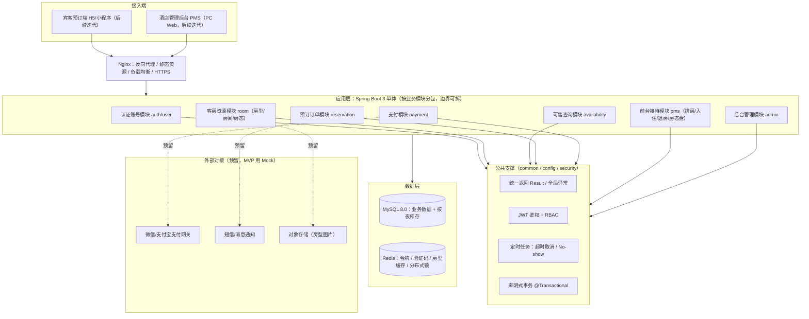
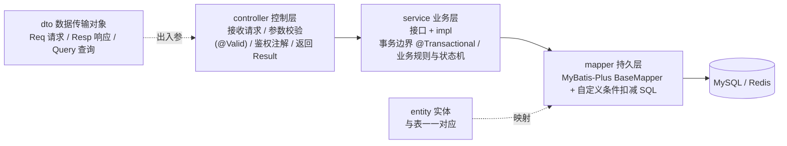
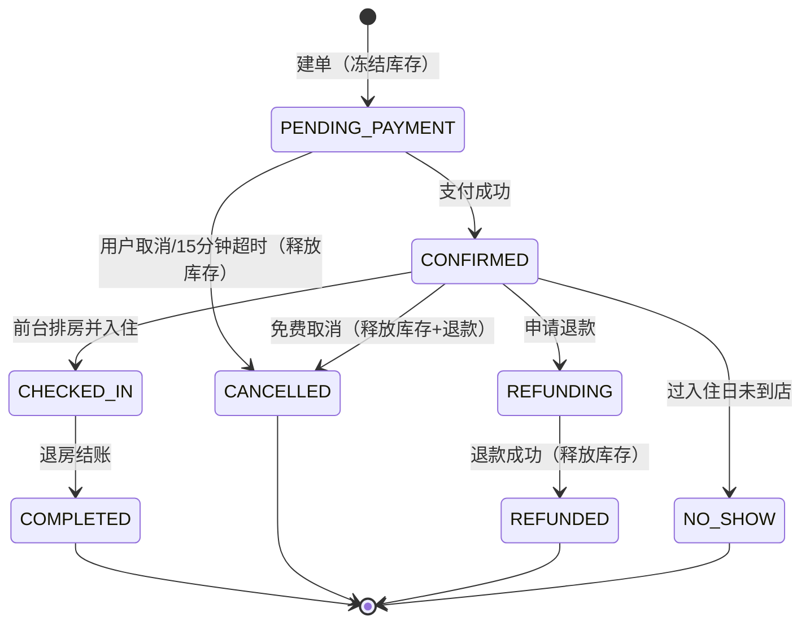
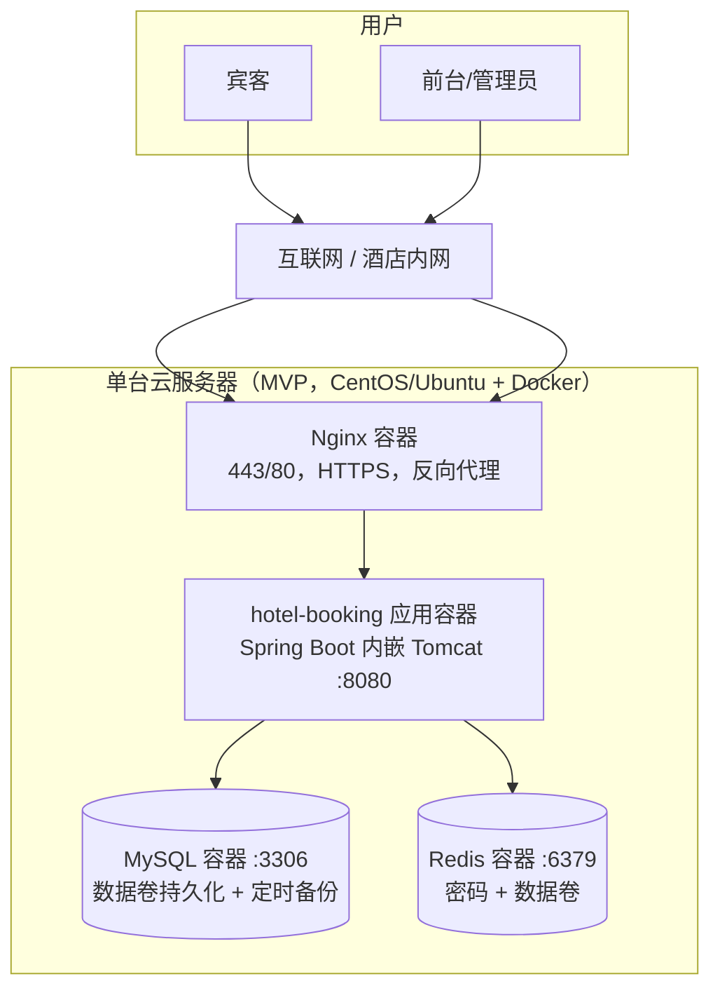

# 酒店客房预订系统 概要设计说明书（HLD）

| 项目 | 内容 |
| --- | --- |
| 文档名称 | 概要设计说明书（High Level Design） |
| 文档版本 | v1.0 |
| 更新日期 | 2026-09-21 |
| 读者 | 架构师、开发组长、一线开发（对应手册设计与架构类·HLD，"系统结构图纸"） |

> 本文档描述系统**整体架构、模块划分、技术选型与部署**；每个模块的内部逻辑、类设计、SQL 见 LLD/DBD/API 文档与代码骨架。

---

## 1. 设计目标与约束
- 核心目标：**高并发下不超卖**、房态与订单强一致、预订链路可追溯；
- 约束：MVP 单体应用优先（易开发、易部署、契合手册"分层适配"中小项目），但模块边界按"未来可拆微服务"划分；
- 技术成熟、资料丰富、与 JDK17/Maven 本机环境匹配，便于后续课程设计/团队开发。

## 2. 总体分层架构



**分层职责（自上而下，依赖只能向下）**
1. **接入层**：Nginx 终结 HTTPS、转发 `/api` 到应用、托管前端静态资源；
2. **应用层**：按业务能力划分 7 个模块，模块之间通过 Service 接口调用，禁止跨模块直接访问对方 Mapper；
3. **公共支撑层**：统一返回/异常、JWT+RBAC、定时任务、事务，避免业务代码重复造轮子；
4. **数据层**：MySQL 持久化（强一致、事务），Redis 承担缓存、令牌与并发锁；
5. **外部对接层**：支付/短信/对象存储全部走"网关接口 + Mock 实现"，后续替换为真实渠道不影响核心链路。

## 3. 业务模块划分与职责

| 模块 | 包名 | 核心职责 | 主要数据表 |
| --- | --- | --- | --- |
| 认证账号 | `module.auth` / `module.user` | 注册、登录、令牌、当前用户、RBAC | `user` |
| 客房资源 | `module.room` | 房型、物理房间、房态、设施图片 | `room_type`、`room` |
| 可售查询 | `module.room`（availability 服务） | 按日期区间计算每夜可售量与总价 | `room_inventory` |
| 预订订单 | `module.reservation` | 建单、事务扣减库存、取消、订单查询、状态机 | `reservation`、`reservation_item`、`room_inventory` |
| 支付 | `module.payment` | 发起支付、回调、退款、支付流水 | `payment` |
| 前台接待 | `module.pms` | 排房、入住、退房、No-show、房态盘 | `reservation`、`room` |
| 后台管理 | `module.pms` / `admin` | 房型房间 CRUD、订单查询、营业概览 | 全部只读 + 资源表 |

**模块间关键依赖**：`reservation` 依赖 `room`（读房型/房价/库存）与 `payment`（确认支付）；`pms` 依赖 `reservation` 与 `room`；`auth` 被所有需要鉴权的模块共享。

## 4. 后端代码分层（单体内部）



- **Controller 不写业务**，只做参数绑定、校验、调用 Service、包装统一返回；
- **业务规则与事务全部在 Service**：建单/取消的多表操作必须在同一事务；
- **Mapper 只做数据访问**：复杂的"条件扣减库存"用自定义 SQL（靠 `WHERE available >= ?` 保证原子性），不用"先查后改"（有并发漏洞）；
- 实体 `entity` 不直接暴露给前端，出入参一律用 `dto`，避免敏感字段（如密码哈希）外泄。

## 5. 技术选型及理由（对应手册"为什么选这个技术栈"）

| 层次 | 选型 | 版本 | 选型理由 |
| --- | --- | --- | --- |
| 语言/运行时 | Java | JDK 17（LTS） | 本机已装 17；酒店/MIS 类系统教学与业界最主流，生态成熟 |
| 应用框架 | Spring Boot | 3.2.x | 自动配置、内嵌 Tomcat、开箱即用；3.x 要求 JDK17，与环境匹配 |
| 持久层 | MyBatis-Plus | 3.5.x | 单表 CRUD 零 SQL，复杂库存扣减可写自定义 SQL，学习曲线平缓 |
| 关系数据库 | MySQL | 8.0（InnoDB/utf8mb4） | 事务支持强、普及度高；行锁保障并发扣减一致性 |
| 缓存/锁 | Redis | 7.x | 登录令牌、验证码、房型查询缓存；可扩展分布式锁兜底防超卖 |
| 接口风格 | RESTful + JSON | - | 资源化 URL、统一动词，前后端分离，便于小程序/Web 复用 |
| 接口文档 | springdoc-openapi（建议后续接入） | 2.x | 自动生成 Swagger，对应手册"Swagger 自动生成 API 文档" |
| 构建 | Maven | 3.6（本机） | 依赖与构建标准化，`pom.xml` 锁定版本 |
| 前端（后续） | Vue3 + Vite + Element Plus | - | 管理后台组件丰富；C 端可选 uni-app 一套多端 |
| 部署 | Docker + docker-compose + Nginx | - | app/mysql/redis 一键起，环境一致，对应手册部署方案 |

> 版本纪律（遵循手册"依赖管理"原则）：`pom.xml` 中依赖**锁定精确版本**，不使用 `^/~/LATEST`，避免"在我电脑上能跑"。

## 6. 关键技术决策（架构重点）

### 6.1 按"夜"库存模型（区别于普通电商）
- 用 `room_inventory(room_type_id, inventory_date, total_count, booked_count)` 表达"某房型某一天的可售量"；
- 物理房间 `room` 用于排房与房态；可售量按房型聚合，预订时不指定具体房间，入住前由前台排房；
- 下单对区间内**每个日期行做条件更新**（BR-07），由数据库行锁 + 条件判断保证**绝不超卖**，无需把请求串行化；
- Redis 分布式锁作为热点日期的**前置兜底**（降低无效打到数据库的并发），但**一致性最终以数据库条件更新为准**（不把正确性建立在 Redis 之上）。

### 6.2 订单状态机

非法跳转在 Service 层统一拦截并抛业务异常（见 AC-06）。

### 6.3 一致性与并发
- 建单、取消、入住、退房均为 `@Transactional` 本地事务，保证订单与库存/房态同进同退；
- 库存扣减用"条件 UPDATE + 影响行数判定"，是高并发防超卖的核心；
- 支付回调做**幂等**（同一 `transaction_id` 重复通知只处理一次），订单号/支付单号唯一索引兜底。

### 6.4 安全
- 登录签发 JWT（含 userId、role、过期时间），令牌放 `Authorization: Bearer <token>`；
- 拦截器统一校验令牌，方法/路径按角色鉴权（RBAC）；
- 密码加盐哈希（骨架内置 SHA-256+随机盐可运行示例，**生产应替换为 BCrypt/Argon2**）；
- 入参用 `@Valid` 校验，防 SQL 注入由 MyBatis 参数绑定保证，敏感字段不返出、不打日志。

## 7. 部署架构（对应手册"部署方案/部署指南"）


- MVP 用 `docker-compose up -d` 一键拉起 **nginx / app / mysql / redis** 四个容器；
- MySQL/Redis 端口默认**不对外暴露**，仅应用容器内网访问；数据库每日凌晨逻辑备份、保留 30 天（详见部署文档）；
- 演进路径：业务增长后可把应用水平扩容为多实例（Nginx 负载均衡），库存热点用 Redis 锁 + 分库分表/读写分离，模块再按边界拆为微服务。

## 8. 工程目录结构（本期骨架）
```
酒店客房预订系统-基础架构/
├─ docs/                # PRD、HLD、DBD、API、非功能与部署、路线与测试
├─ database/
│  ├─ schema.sql        # 建库建表（可直接执行）
│  └─ seed.sql          # 初始数据（房型/房间/库存/管理员）
└─ backend/             # Spring Boot 3 工程骨架
   ├─ pom.xml
   └─ src/main/
      ├─ java/com/hotel/booking/
      │  ├─ HotelBookingApplication.java
      │  ├─ common/         # Result、ResultCode、PageResult、BusinessException、GlobalExceptionHandler
      │  ├─ config/         # MyBatis-Plus 等配置
      │  ├─ security/       # JWT 工具、鉴权拦截器、当前用户上下文（骨架）
      │  └─ module/
      │     ├─ auth|user|room|reservation|payment|pms
      │     │  每个模块含 controller/service/mapper/entity/dto
      └─ resources/
         ├─ application.yml # 数据源/Redis/业务配置（占位，按环境修改）
         └─ mapper/         # 复杂 SQL 的 XML（如需要）
```

## 9. 待 LLD/代码细化的点
- 建单、取消、入住、退房的**逐步骤流程图与事务边界**（已在代码 `ReservationServiceImpl` 中以可运行示例体现）；
- 库存条件扣减/回滚 SQL（见 `RoomInventoryMapper` 与 DBD）；
- 支付回调状态转换与幂等表/唯一键（见 payment 模块与 API 文档）。
