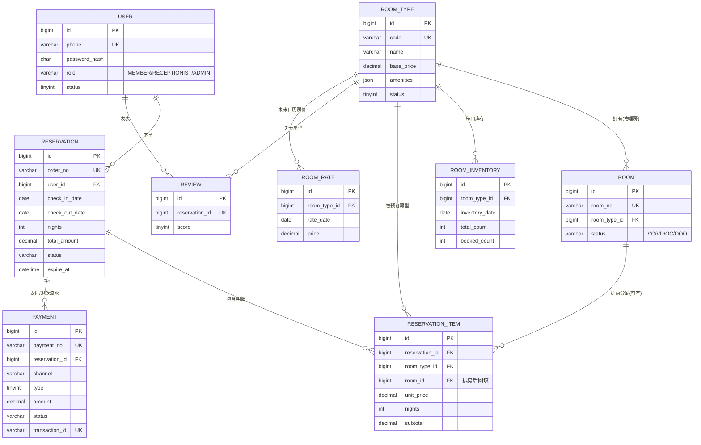

# 酒店客房预订系统 数据库设计说明书（DBD）

| 项目 | 内容 |
| --- | --- |
| 文档名称 | 数据库设计说明书（Database Design Document） |
| 文档版本 | v1.0 |
| 更新日期 | 2026-09-21 |
| 配套脚本 | `database/schema.sql`（建表）、`database/seed.sql`（种子数据） |
| 读者 | 后端开发、DBA、测试（对应手册设计与架构类·DBD，数据库"解剖图"） |

---

## 1. 设计约定（命名与规范）
- 数据库 `hotel_booking`：**MySQL 8.0+、InnoDB、utf8mb4 / utf8mb4_unicode_ci**；
- 主键统一 `id BIGINT UNSIGNED AUTO_INCREMENT`；金额统一 `DECIMAL(10,2)`，**禁止用浮点存钱**；
- 时间统一 `DATETIME`，`created_at`/`updated_at` 由默认值与 `ON UPDATE` 自动维护；
- 表名、字段名使用蛇形小写（snake_case），表名用单数；索引 `uk_` 唯一、`idx_` 普通、`chk_` 检查约束；
- **采用逻辑外键，不建物理 FOREIGN KEY**：关系完整性由应用事务、唯一索引、条件更新保证。理由：物理外键在高并发写入、批量导入、未来分库分表时带来额外锁与耦合，互联网项目普遍用逻辑外键；课程/小项目若偏好强约束，可据此脚本自行补建外键；
- 资源"删除"采用**停用**（`status=0`）而非物理删除，以保留订单历史可追溯；
- 可售量 `available = total_count - booked_count` **不落库**，避免冗余数据不一致；`CHECK` 约束作为兜底防止 `booked_count` 越界。

## 2. ER 图（实体关系）



## 3. 数据字典

### 3.1 user 用户表（会员与员工）
| 字段 | 类型 | 空 | 默认 | 说明 |
| --- | --- | --- | --- | --- |
| id | BIGINT UNSIGNED | 否 | 自增 | 用户ID |
| phone | VARCHAR(20) | 否 | - | 手机号，唯一，登录账号 |
| password_hash | CHAR(64) | 否 | - | SHA-256(盐+密码) 十六进制 |
| salt | VARCHAR(32) | 否 | - | 密码盐 |
| name | VARCHAR(50) | 是 | NULL | 姓名/昵称 |
| id_card | VARCHAR(32) | 是 | NULL | 身份证（生产应加密） |
| gender | TINYINT | 否 | 0 | 0未知/1男/2女 |
| role | VARCHAR(20) | 否 | MEMBER | MEMBER/RECEPTIONIST/ADMIN |
| member_level | TINYINT | 否 | 1 | 会员等级 |
| points | INT | 否 | 0 | 积分（迭代） |
| status | TINYINT | 否 | 1 | 1正常/0停用 |
| created_at / updated_at | DATETIME | 否 | 自动 | 时间戳 |

### 3.2 room_type 房型表
| 字段 | 类型 | 空 | 默认 | 说明 |
| --- | --- | --- | --- | --- |
| id | BIGINT UNSIGNED | 否 | 自增 | 房型ID |
| code | VARCHAR(32) | 否 | - | 房型编码，唯一（STD/TWN/DLX/SUI） |
| name | VARCHAR(50) | 否 | - | 房型名称 |
| bed_type | VARCHAR(32) | 是 | NULL | 床型 |
| max_occupancy | INT | 否 | 2 | 最大入住人数 |
| area | DECIMAL(6,2) | 是 | NULL | 面积㎡ |
| base_price | DECIMAL(10,2) | 否 | - | 基础房价（元/间夜） |
| description | VARCHAR(500) | 是 | NULL | 描述 |
| cover_image | VARCHAR(255) | 是 | NULL | 封面图 URL |
| amenities | JSON | 是 | NULL | 设施数组 |
| status | TINYINT | 否 | 1 | 1上架/0停用 |
| sort_order | INT | 否 | 0 | 排序 |

### 3.3 room 物理房间表
| 字段 | 类型 | 空 | 默认 | 说明 |
| --- | --- | --- | --- | --- |
| id | BIGINT UNSIGNED | 否 | 自增 | 房间ID |
| room_no | VARCHAR(16) | 否 | - | 房间号，唯一 |
| room_type_id | BIGINT UNSIGNED | 否 | - | 所属房型 |
| floor | INT | 是 | NULL | 楼层 |
| status | VARCHAR(8) | 否 | VC | VC空闲可售/VD待清洁/OC在住/OOO维修 |
| remark | VARCHAR(255) | 是 | NULL | 备注 |

### 3.4 room_inventory 房型每日库存表（按夜售卖核心）
| 字段 | 类型 | 空 | 默认 | 说明 |
| --- | --- | --- | --- | --- |
| id | BIGINT UNSIGNED | 否 | 自增 | 库存ID |
| room_type_id | BIGINT UNSIGNED | 否 | - | 房型 |
| inventory_date | DATE | 否 | - | 日期（某一夜） |
| total_count | INT | 否 | 0 | 当日总房量 |
| booked_count | INT | 否 | 0 | 已订间数 |
| 约束 | - | - | - | 唯一键 `(room_type_id,inventory_date)`；`CHECK(0<=booked_count<=total_count)` |

> 下单扣减（原子条件更新，防超卖核心）：
> ```sql
> UPDATE room_inventory
>    SET booked_count = booked_count + #{qty}
>  WHERE room_type_id = #{roomTypeId}
>    AND inventory_date = #{date}
>    AND total_count - booked_count >= #{qty};
> -- 受影响行数 = 0 即该夜库存不足，回滚整单
> ```
> 取消/退款回滚：`SET booked_count = booked_count - #{qty} WHERE ...`。

### 3.5 reservation 订单主表
| 字段 | 类型 | 空 | 默认 | 说明 |
| --- | --- | --- | --- | --- |
| id | BIGINT UNSIGNED | 否 | 自增 | 订单ID |
| order_no | VARCHAR(32) | 否 | - | 订单号，唯一 |
| user_id | BIGINT UNSIGNED | 否 | - | 下单会员 |
| contact_name | VARCHAR(50) | 否 | - | 联系人 |
| contact_phone | VARCHAR(20) | 否 | - | 联系手机 |
| check_in_date | DATE | 否 | - | 入住日期 |
| check_out_date | DATE | 否 | - | 离店日期（CHECK 离店>入住） |
| nights | INT | 否 | - | 间夜数（CHECK ≥1） |
| total_amount | DECIMAL(10,2) | 否 | 0 | 总额 |
| status | VARCHAR(20) | 否 | PENDING_PAYMENT | 订单状态机（见 HLD/PRD BR-10） |
| source | VARCHAR(16) | 否 | ONLINE | ONLINE/FRONT |
| remark | VARCHAR(255) | 是 | NULL | 备注 |
| deposit | DECIMAL(10,2) | 否 | 0 | 押金 |
| expire_at | DATETIME | 是 | NULL | 支付截止时间 |
| paid_at | DATETIME | 是 | NULL | 支付时间 |
| actual_check_in_at / actual_check_out_at | DATETIME | 是 | NULL | 实际入住/退房 |
| cancel_time | DATETIME | 是 | NULL | 取消时间 |

### 3.6 reservation_item 订单明细表（一行=一间房住 N 夜）
| 字段 | 类型 | 空 | 默认 | 说明 |
| --- | --- | --- | --- | --- |
| id | BIGINT UNSIGNED | 否 | 自增 | 明细ID |
| reservation_id | BIGINT UNSIGNED | 否 | - | 订单 |
| room_type_id | BIGINT UNSIGNED | 否 | - | 房型 |
| room_id | BIGINT UNSIGNED | 是 | NULL | 排房后回填的具体房间 |
| unit_price | DECIMAL(10,2) | 否 | - | 锁定的每夜单价 |
| nights | INT | 否 | - | 夜数 |
| subtotal | DECIMAL(10,2) | 否 | - | 小计=单价×夜数 |

### 3.7 payment 支付流水表
| 字段 | 类型 | 空 | 默认 | 说明 |
| --- | --- | --- | --- | --- |
| id | BIGINT UNSIGNED | 否 | 自增 | 流水ID |
| payment_no | VARCHAR(32) | 否 | - | 支付流水号，唯一 |
| reservation_id | BIGINT UNSIGNED | 否 | - | 订单ID |
| order_no | VARCHAR(32) | 否 | - | 订单号（对账冗余） |
| channel | VARCHAR(16) | 否 | - | WECHAT/ALIPAY/CASH |
| type | TINYINT | 否 | 1 | 1支付/2退款 |
| amount | DECIMAL(10,2) | 否 | - | 金额 |
| status | VARCHAR(16) | 否 | INIT | INIT/SUCCESS/FAIL/REFUNDED |
| transaction_id | VARCHAR(64) | 是 | NULL | 第三方交易号，**唯一，回调幂等** |
| paid_at | DATETIME | 是 | NULL | 完成时间 |

### 3.8 评价表与预留表
- **review 评价表**：用于房型平均评分和评论展示；`reservation_id` 唯一（一单一评）、`score(1-5)`、`content`、`images(JSON)`、`status`；
- **room_rate 日历房价表**：`(room_type_id, rate_date)` 唯一、`price`，用于周末/节假日动态定价；
- **notification_log 通知记录表**：`type/channel/title/content/biz_no/status/send_time`。

## 4. 索引设计（含理由）
| 表 | 索引 | 类型 | 服务的查询/作用 |
| --- | --- | --- | --- |
| user | uk_user_phone(phone) | 唯一 | 登录、手机号唯一约束 |
| user | idx_user_role(role) | 普通 | 按角色筛员工 |
| room_type | uk_room_type_code(code) | 唯一 | 房型编码唯一 |
| room | uk_room_no(room_no) | 唯一 | 房间号唯一 |
| room | idx_room_type / idx_room_status | 普通 | 按房型聚合房量、房态盘筛选 |
| room_inventory | uk_inventory_type_date(type,date) | 唯一 | 库存定位与防重，覆盖扣减 SQL |
| room_inventory | idx_inventory_date(date) | 普通 | 按日期范围扫描可售 |
| reservation | uk_reservation_order_no | 唯一 | 订单号唯一、单号查询 |
| reservation | idx_reservation_user(user_id) | 普通 | "我的订单" |
| reservation | idx_reservation_status_expire(status,expire_at) | 联合 | 定时扫描"待支付且已过期"订单 |
| reservation | idx_reservation_dates | 普通 | 按入住区间报表/排房查询 |
| reservation_item | idx_item_reservation / idx_item_room / idx_item_type | 普通 | 订单明细、排房冲突判定、按房型统计 |
| payment | uk_payment_no / uk_payment_transaction | 唯一 | 流水号唯一、第三方回调幂等 |
| payment | idx_payment_reservation | 普通 | 按订单查流水 |
| review | uk_review_reservation | 唯一 | 一单一评 |
| review | idx_review_type_status | 普通 | 按房型和显示状态查询评论、统计评分 |
| room_rate | uk_rate_type_date | 唯一 | 某房型某日房价唯一 |

## 5. 关键查询：区间可售量（对应 PRD BR-05/06）
查询某房型在 `[入住, 离店)` 区间内**每一夜都可售的间数**（取区间内最小剩余）：
```sql
SELECT MIN(total_count - booked_count) AS min_available
  FROM room_inventory
 WHERE room_type_id = #{roomTypeId}
   AND inventory_date >= #{checkIn}
   AND inventory_date <  #{checkOut};   -- 离店当日不计费、不占库存
-- min_available >= 预订间数 才允许下单；任一夜为 0 即不可订
```

## 6. 排房冲突判定（对应 BR-09）
同一物理房间不可与已排房订单的入住区间重叠（半开区间 `[入住, 离店)`）：
```sql
SELECT COUNT(*) FROM reservation_item ri
JOIN reservation r ON r.id = ri.reservation_id
WHERE ri.room_id = #{roomId}
  AND r.status IN ('CONFIRMED','CHECKED_IN')
  AND r.check_in_date <  #{checkOut}
  AND r.check_out_date > #{checkIn};   -- 区间重叠条件
-- COUNT > 0 即冲突，禁止排该房
```

## 7. 数据初始化与迁移方案（对应手册"数据迁移方案"）
- **首次初始化**：先执行 `schema.sql` 建库建表，再执行 `seed.sql` 写入账号/房型/房间并自动生成未来 90 天库存；
- **库存滚动**：上线后由定时任务每天为新的日期补库存行（房量取该房型非维修房间数），保证可预订天数滚动覆盖（如 90 天）；
- **结构演进**：建议引入 **Flyway**（`src/main/resources/db/migration/V1__init.sql`、`V2__xxx.sql`）管理版本化迁移，所有表结构变更只增不改、可追溯，杜绝"文档与库结构脱节"（手册版本管理原则）；
- **备份恢复**：MySQL 每日凌晨逻辑备份（mysqldump）保留 30 天，详见部署运维文档。
